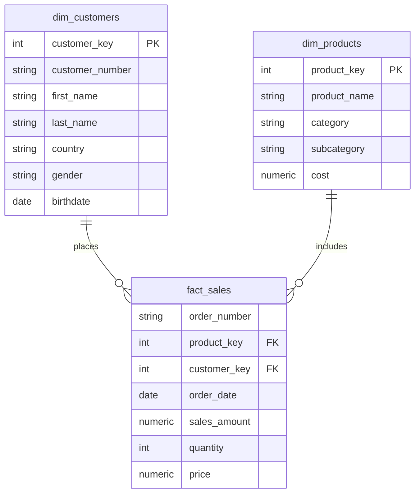
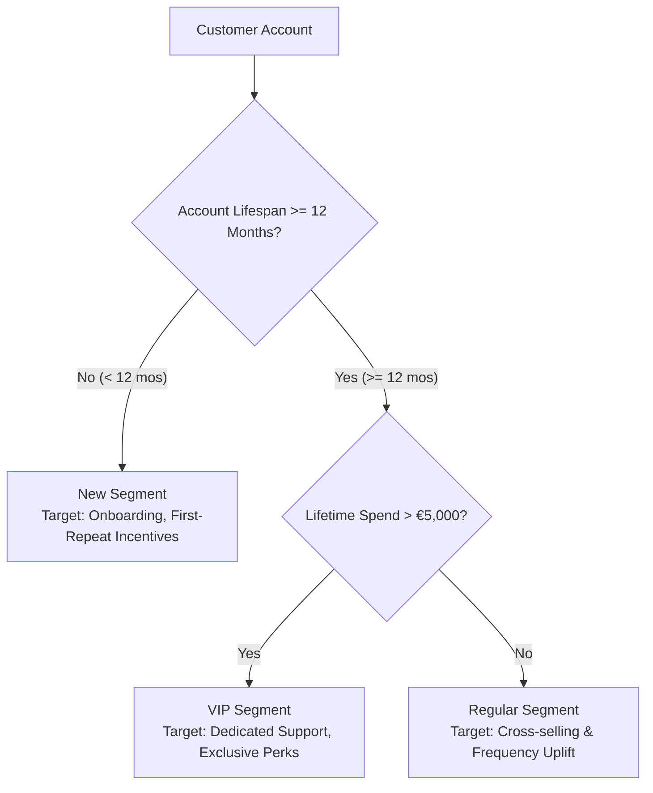

# SQL Data Analytics & Dimensional Modeling Project

[](https://www.microsoft.com/en-us/sql-server)
[](https://learn.microsoft.com/en-us/sql/t-sql/)
[-gold)](docs/data_architecture_and_model.md)
[]()

A comprehensive, end-to-end SQL data analytics and business intelligence project. This project implements a dimensional Star Schema data mart, performs rigorous exploratory data analysis (EDA), trend modeling, customer segmentation, and builds an enterprise-ready analytical view for customer reporting.

---

## 📌 Table of Contents

- [Project Overview](#-project-overview)
- [Data Architecture & Model](#-data-architecture--model)
- [Repository Structure](#-repository-structure)
- [Analytical Roadmap & Scripts](#-analytical-roadmap--scripts)
- [Key Business Insights & Metrics](#-key-business-insights--metrics)
- [Getting Started & Execution](#-getting-started--execution)
- [Project Documentation](#-project-documentation)

---

## 🚀 Project Overview

The objective of this project is to extract actionable commercial intelligence from retail sales transaction data. Operating within the **Gold Layer** of a dimensional data warehouse, this analytical framework progresses from foundational exploration to advanced customer cohort segmentation and Year-over-Year (YoY) performance benchmarking.

### Core Business Objectives
- **Understand Revenue & Sales Volume**: Monitor top-line sales, unit volume, and order frequency across products and markets.
- **Track Temporal Trends**: Uncover seasonality, calculate cumulative annual sales, and quantify month-over-month shifts.
- **Benchmark Catalog Performance**: Identify high-margin and underperforming products using window ranking and YoY variance metrics.
- **Cohort Segmentation**: Classify customer accounts into behavioral segments (`VIP`, `Regular`, `New`) and demographic age groups to guide targeted customer retention strategies.

---

## 🏗 Data Architecture & Model

The analytical data mart is modeled as a **Star Schema** with `gold.fact_sales` at the center, joined to customer and product dimension tables.



> 📖 **Deep Dive**: For full schema definitions, field data types, and primary/foreign key mappings, see the [Data Architecture & Model Documentation](docs/data_architecture_and_model.md).

---

## 📂 Repository Structure

```text
sql-data-analytics-project/
│
├── README.md                                # Master project documentation
│
├── docs/                                    # Detailed architectural and business guides
│   ├── data_architecture_and_model.md       # Star Schema ERD, table schemas, and data dictionary
│   ├── business_requirements_and_kpis.md    # KPIs definitions, segmentation rules, business logic
│   └── analytical_framework.md              # In-depth breakdown of analytical phases & SQL techniques
│
└── scripts/                                 # Sequenced modular SQL analytics scripts
    ├── 01_database_exploration.sql          # Database metadata, schemas, and table inspection
    ├── 02_dimensions_exploration.sql        # Exploration of customer regions & product hierarchies
    ├── 03_date_range_exploration.sql        # Timespan validation & customer age distribution
    ├── 04_measures_exploration.sql          # Core KPI aggregations & business metrics scorecard
    ├── 05_magnitude_analysis.sql            # Distribution of volume & revenue across dimensions
    ├── 06_ranking_analysis.sql              # Top 5 and bottom 5 products (RANK window function)
    ├── 07_change_over_time_analysis.sql     # Trend & seasonality analysis across months and years
    ├── 08_cumulative_analysis.sql           # Running total of sales partitioned by year
    ├── 09_performance_analysis.sql          # Product YoY growth analysis using LAG window functions
    ├── 10_part_to_whole_analysis.sql        # Category sales share vs total overall revenue
    ├── 11_data_segmentation_analysis.sql    # Product cost tiers & VIP/Regular/New customer cohorts
    └── 12_customer_report.sql               # Production-ready view (gold.report_customers)
```

---

## 📜 Analytical Roadmap & Scripts

The SQL scripts in [`scripts/`](scripts/) follow an intentional, numbered sequence designed for reproducible data analytics:

| Stage | Script | Analytical Focus | Core SQL Concepts |
| :---: | :--- | :--- | :--- |
| **01** | [`01_database_exploration.sql`](scripts/01_database_exploration.sql) | Database Metadata & Structure | `INFORMATION_SCHEMA.TABLES`, `INFORMATION_SCHEMA.COLUMNS` |
| **02** | [`02_dimensions_exploration.sql`](scripts/02_dimensions_exploration.sql) | Dimension & Hierarchy Inspection | `SELECT DISTINCT`, Multi-column Ordering |
| **03** | [`03_date_range_exploration.sql`](scripts/03_date_range_exploration.sql) | Temporal Boundaries & Demographics | `MIN()`, `MAX()`, `DATEDIFF()` |
| **04** | [`04_measures_exploration.sql`](scripts/04_measures_exploration.sql) | Core Business Metrics Scorecard | `COUNT(DISTINCT)`, `EXISTS`, `UNION ALL` |
| **05** | [`05_magnitude_analysis.sql`](scripts/05_magnitude_analysis.sql) | Cross-Dimensional Aggregations | `GROUP BY`, `ORDER BY DESC`, Multi-table `LEFT JOIN` |
| **06** | [`06_ranking_analysis.sql`](scripts/06_ranking_analysis.sql) | Best & Worst Product Identification | `TOP N`, Window Function `RANK() OVER (ORDER BY)` |
| **07** | [`07_change_over_time_analysis.sql`](scripts/07_change_over_time_analysis.sql) | Trend & Seasonality Detection | `DATETRUNC()`, `FORMAT()`, `YEAR()`, `MONTH()` |
| **08** | [`08_cumulative_analysis.sql`](scripts/08_cumulative_analysis.sql) | Progressive Sales Tracking | Cumulative `SUM() OVER (PARTITION BY ... ORDER BY)` |
| **09** | [`09_performance_analysis.sql`](scripts/09_performance_analysis.sql) | Year-over-Year (YoY) Growth | CTEs, `AVG() OVER()`, `LAG() OVER()`, `CASE WHEN` |
| **10** | [`10_part_to_whole_analysis.sql`](scripts/10_part_to_whole_analysis.sql) | Proportional Contribution | Unbounded `SUM() OVER()`, `CAST() AS FLOAT` |
| **11** | [`11_data_segmentation_analysis.sql`](scripts/11_data_segmentation_analysis.sql) | Behavioral & Cost Segmentation | Conditional `CASE WHEN`, Lifespan Grouping |
| **12** | [`12_customer_report.sql`](scripts/12_customer_report.sql) | Consolidated Data Mart View | `CREATE VIEW`, CTE Pipelines, `NULLIF()` Protection |

---

## 💡 Key Business Insights & Metrics

### 1. Executive Metrics Scorecard
Calculated dynamically in [`04_measures_exploration.sql`](scripts/04_measures_exploration.sql):
- **Total Revenue**: Aggregate monetary volume across all transactions.
- **Total Quantity Sold**: Cumulative units moved through fulfillment.
- **Average Selling Price (ASP)**: Mean line-item price realized.
- **Customer Conversion Rate**: Proportion of registered accounts that have placed at least one confirmed order.

### 2. Customer Segmentation Architecture
Implemented in [`11_data_segmentation_analysis.sql`](scripts/11_data_segmentation_analysis.sql) and materialized in [`12_customer_report.sql`](scripts/12_customer_report.sql):



### 3. Year-over-Year Product Performance
In [`09_performance_analysis.sql`](scripts/09_performance_analysis.sql), each product's yearly revenue is benchmarked simultaneously against:
- Its **lifetime historical average** (`current_sales - avg_sales`) to evaluate historical health (`Above Avg` / `Below Avg`).
- Its **prior year sales** using `LAG()` (`current_sales - previous_year_sales`) to track annual trajectory (`Increase` / `Decrease`).

---

## 🛠 Getting Started & Execution

### Prerequisites
- **RDBMS**: Microsoft SQL Server 2017+ or Azure SQL Database.
- **IDE**: [SQL Server Management Studio (SSMS)](https://learn.microsoft.com/en-us/sql/ssms/download-sql-server-management-studio-ssms) or [Azure Data Studio](https://learn.microsoft.com/en-us/azure-data-studio/download-azure-data-studio).
- Access to the target database containing the `gold` schema (`gold.fact_sales`, `gold.dim_customers`, `gold.dim_products`).

### Execution Guide
1. **Clone the Repository**:
   ```bash
   git clone https://github.com/your-username/sql-data-analytics-project.git
   cd sql-data-analytics-project
   ```
2. **Execute Exploration Scripts**:
   Open and execute scripts `01` through `04` in SSMS or Azure Data Studio to inspect schema structures, categorical dimensions, date ranges, and core metrics.
3. **Execute Analysis & Segmentation**:
   Run scripts `05` through `11` to perform deep-dive ranking, trend detection, cumulative running totals, and cohort segmentation.
4. **Deploy the Customer Report View**:
   Run [`12_customer_report.sql`](scripts/12_customer_report.sql) to compile the analytical view:
   ```sql
   -- Query the compiled analytical customer view
   SELECT TOP 100 *
   FROM gold.report_customers
   ORDER BY total_sales DESC;
   ```

---

## 📚 Project Documentation

For comprehensive technical and business specifications, consult the dedicated guides in the `docs/` folder:

- 📊 [Data Architecture & Model Guide](docs/data_architecture_and_model.md) — Star Schema architecture, ER diagram, and table data dictionary.
- 🎯 [Business Requirements & KPIs](docs/business_requirements_and_kpis.md) — Analytical objectives, KPI definitions, and customer segmentation rules.
- 🔬 [Analytical Framework & Methodology](docs/analytical_framework.md) — Step-by-step roadmap of queries, window functions, and SQL best practices.

---

## 📄 License
This project is open-source and available under the [MIT License](LICENSE).

