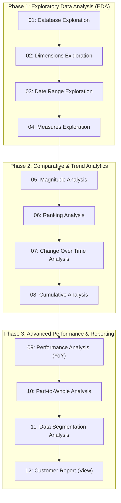

# Analytical Framework & SQL Methodology

This document details the progressive 12-stage analytical workflow implemented across the project's SQL scripts, highlighting the business objectives, core queries, and advanced SQL techniques applied in each stage.

---

## 1. The 12-Stage Analytical Roadmap

---

## 2. Stage-by-Stage Breakdown

### Stage 01: Database Exploration
- **File**: `01_database_exploration.sql`
- **Focus**: Metadata discovery and schema inspection.
- **Key Concepts**: `INFORMATION_SCHEMA.TABLES`, `INFORMATION_SCHEMA.COLUMNS`.
- **Purpose**: Systematically inspect database objects, tables, column names, and data types before executing business logic.

---

### Stage 02: Dimensions Exploration
- **File**: `02_dimensions_exploration.sql`
- **Focus**: Categorical structure and hierarchy exploration.
- **Key Concepts**: `SELECT DISTINCT`, multi-column ordering.
- **Purpose**: Map out customer geographical spread (`country`) and product catalog hierarchies (`category` > `subcategory` > `product_name`).

---

### Stage 03: Date Range Exploration
- **File**: `03_date_range_exploration.sql`
- **Focus**: Temporal boundaries and demographic age distribution.
- **Key Concepts**: `MIN()`, `MAX()`, `DATEDIFF(year, ...)`, `DATEDIFF(month, ...)`.
- **Purpose**: Determine the operational lifespan of transaction records and customer age boundaries.

---

### Stage 04: Measures Exploration
- **File**: `04_measures_exploration.sql`
- **Focus**: High-level KPIs and consolidated metrics reporting.
- **Key Concepts**: `COUNT(DISTINCT ...)`, `AVG()`, `SUM()`, `EXISTS`, `UNION ALL`.
- **Purpose**: Compute global measures (total sales, quantities, order count, unique products, active customers) and construct a unified KPI summary table using `UNION ALL`.

---

### Stage 05: Magnitude Analysis
- **File**: `05_magnitude_analysis.sql`
- **Focus**: Distribution across categorical dimensions.
- **Key Concepts**: `GROUP BY`, `ORDER BY ... DESC`, `LEFT JOIN`.
- **Purpose**: Evaluate customer counts by country and gender, product counts by category, average category cost, and top spending customers.

---

### Stage 06: Ranking Analysis
- **File**: `06_ranking_analysis.sql`
- **Focus**: Top and bottom performing products.
- **Key Concepts**: `TOP N`, Window Function `RANK() OVER (ORDER BY ...)`, Subqueries.
- **Purpose**: Identify the 5 most profitable products as well as the 5 lowest-performing items to guide catalog optimization and inventory restocking.

---

### Stage 07: Change Over Time Analysis
- **File**: `07_change_over_time_analysis.sql`
- **Focus**: Trend analysis and seasonality detection.
- **Key Concepts**: `DATETRUNC()`, `FORMAT(..., 'yyyy-MM')`, `YEAR()`, `MONTH()`.
- **Purpose**: Analyze monthly sales performance, identifying peaks, troughs, and customer volume trends across different calendar periods.

---

### Stage 08: Cumulative Analysis
- **File**: `08_cumulative_analysis.sql`
- **Focus**: Running totals and progressive sales tracking.
- **Key Concepts**: Window aggregation `SUM(...) OVER (PARTITION BY YEAR(...) ORDER BY ...)`.
- **Purpose**: Track cumulative revenue accumulation month-by-month throughout each fiscal year.

---

### Stage 09: Performance Analysis (Year-over-Year)
- **File**: `09_performance_analysis.sql`
- **Focus**: Historical comparisons and growth rate tracking.
- **Key Concepts**: Common Table Expressions (CTEs), `AVG(...) OVER (PARTITION BY ...)`, `LAG(...) OVER (PARTITION BY ... ORDER BY ...)`, `CASE WHEN`.
- **Purpose**: Compare current product sales against lifetime product averages and previous year performance to flag growth (`Increase`), contraction (`Decrease`), or neutral trends.

---

### Stage 10: Part-to-Whole Analysis
- **File**: `10_part_to_whole_analysis.sql`
- **Focus**: Proportional contribution and revenue composition.
- **Key Concepts**: Unbounded window aggregation `SUM(...) OVER()`, `ROUND()`, `CAST(...) AS FLOAT`.
- **Purpose**: Quantify the exact percentage contribution of each product category to total sales.

---

### Stage 11: Data Segmentation Analysis
- **File**: `11_data_segmentation_analysis.sql`
- **Focus**: Behavioral customer cohorts and product cost tiers.
- **Key Concepts**: Multi-condition `CASE WHEN`, CTEs, lifespan calculations (`DATEDIFF`).
- **Purpose**: Partition products into cost brackets and segment customers into `VIP`, `Regular`, and `New` segments based on longevity and lifetime spending.

---

### Stage 12: Customer Report (Gold View)
- **File**: `12_customer_report.sql`
- **Focus**: Enterprise data mart view creation.
- **Key Concepts**: `CREATE VIEW`, Multi-CTE pipeline (`base_query` -> `customer_aggregation`), `NULLIF()` division protection.
- **Purpose**: Materialize a comprehensive customer view (`gold.report_customers`) ready for consumption by BI tools (Power BI, Tableau) and business stakeholders.

---

## 3. SQL Best Practices Demonstrated

1. **Defensive Arithmetic**: Utilizing `NULLIF(total_order, 0)` and `NULLIF(life_span, 0)` to guarantee resilience against division-by-zero runtime errors.
2. **Modular CTE Pipelines**: Decomposing complex queries into readable, maintainable, and testable Common Table Expressions.
3. **Optimized Windowing**: Applying window frames and partitions (`PARTITION BY`, `ORDER BY`) to compute analytical metrics in a single scan without repetitive table self-joins.
4. **Standardized Formatting**: Consistent indentation, uppercase keywords, and structured multi-line block headers across all scripts.

