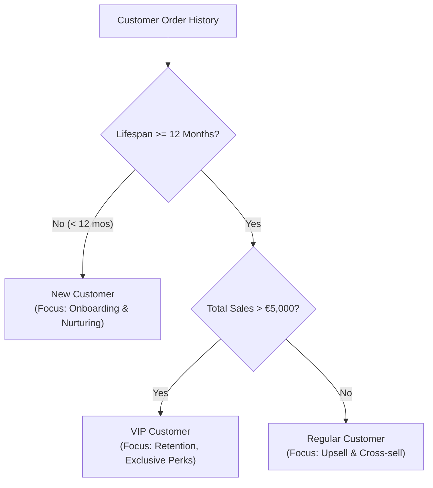

# Business Requirements & Key Performance Indicators (KPIs)

This document formalizes the analytical scope, business objectives, calculation logic, and segmentation criteria used throughout the project.

---

## 1. Project Objectives & Business Questions

The executive and commercial teams require answers to critical business questions to guide strategic investments, product inventory, and customer retention:

1. **Baseline Health & Metrics**: What is the overall sales volume, total revenue, average order value, and active customer base?
2. **Geographical & Demographic Reach**: Where are our customers located, what is their demographic breakdown, and which regions drive the highest volume?
3. **Product Performance**: Which categories and individual products drive top revenue, and which underperform?
4. **Growth & Seasonality**: How do sales fluctuate month-over-month and year-over-year? Is there measurable seasonal demand?
5. **Cumulative Velocity**: How fast does annual sales volume accumulate throughout the fiscal cycle?
6. **Customer Retention & Value**: How are customers distributed by lifespan and total expenditure? Who are our high-value VIP accounts?

---

## 2. Key Performance Indicators (KPIs)

| KPI Name | Technical Definition / SQL Formula | Business Significance |
| :--- | :--- | :--- |
| **Total Revenue** | `SUM(sales_amount)` | Core top-line financial metric representing gross transaction volume. |
| **Total Units Sold** | `SUM(quantity)` | Measures product demand and physical supply throughput. |
| **Average Selling Price (ASP)** | `AVG(price)` | Tracks baseline pricing trends across products sold. |
| **Average Order Value (AOV)** | `total_sales / NULLIF(total_orders, 0)` | Monitors basket size and purchasing power per transaction. |
| **Total Orders** | `COUNT(DISTINCT order_number)` | Quantifies total transaction volume over a period. |
| **Customer Retention Rate** | `(Customers with Orders) / (Total Customers) * 100` | Indicates conversion and engagement of registered accounts. |
| **Order Recency** | `DATEDIFF(month, MAX(order_date), GETDATE())` | Days or months since a customer's last order (churn risk indicator). |
| **Customer Lifespan** | `DATEDIFF(month, MIN(order_date), MAX(order_date))` | Total duration in months a customer has maintained purchasing activity. |
| **Average Monthly Spend** | `total_sales / NULLIF(life_span, 0)` | Ongoing monthly monetary value provided by an active customer. |

---

## 3. Segmentation Logic & Criteria

### 3.1. Customer Behavioral Segmentation
Customers are categorized into three distinct operational tiers to inform targeted retention and loyalty campaigns:

- **VIP**: `life_span >= 12 AND total_sales > 5000`  
  High-value, loyal customers with sustained tenure.
- **Regular**: `life_span >= 12 AND total_sales <= 5000`  
  Established customers with lower average expenditure per cycle.
- **New**: `life_span < 12`  
  Recent acquisitions who require nurturing to become long-term repeat buyers.

---

### 3.2. Demographic Age Grouping
Customers are classified into standard demographic cohorts derived from date of birth:

- **Under 20**: Age `< 20`
- **20 - 29**: Age `BETWEEN 20 AND 29`
- **30 - 39**: Age `BETWEEN 30 AND 39`
- **40 - 49**: Age `BETWEEN 40 AND 49`
- **50 and above**: Age `>= 50`

---

### 3.3. Product Cost Tiering
Catalog merchandise is grouped by unit procurement/manufacturing cost:

- **Below 100**: Low-cost, entry-level products (`cost < 100`)
- **100 - 500**: Mid-tier catalog products (`cost BETWEEN 100 AND 500`)
- **100 - 1000**: Extended commercial products (`cost BETWEEN 100 AND 1000`)
- **Above 1000**: Premium, high-investment products (`cost > 1000`)

