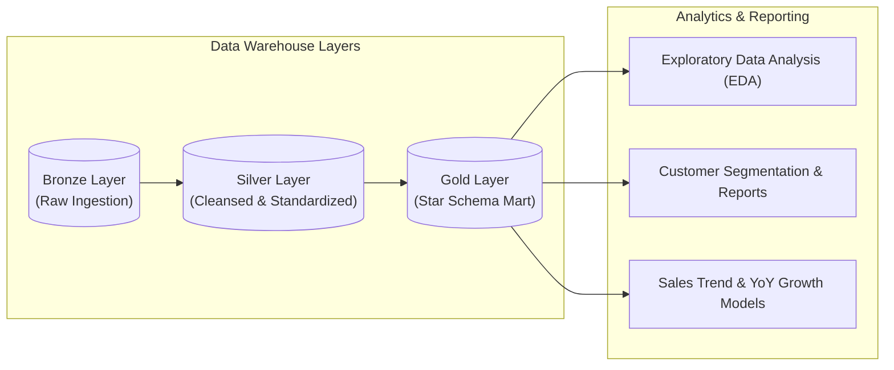
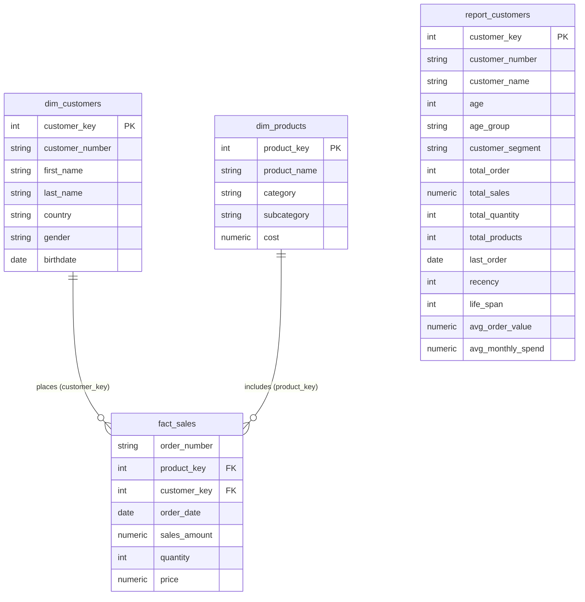

# Data Architecture & Data Model

This document outlines the architectural design, dimensional modeling approach, and data dictionary for the SQL Data Analytics Project.

---

## 1. Architectural Overview

The project is built upon a modern dimensional data warehouse architecture utilizing the **Medallion (Bronze/Silver/Gold)** pattern. The analytical queries and views in this repository interact directly with the **Gold Layer**, which hosts clean, business-ready dimensional models optimized for reporting and analytics.

---

## 2. Dimensional Data Model (Star Schema)

The analytical data mart is structured as a **Star Schema** centered around sales transactions, enabling high-performance aggregations and intuitive relational joins across customers and products.

---

## 3. Data Dictionary

### 3.1. Fact Table: `gold.fact_sales`
Records individual transaction line items across all customer orders.

| Column Name | Data Type | Key Type | Description |
| :--- | :--- | :--- | :--- |
| `order_number` | `NVARCHAR(50)` | - | Unique alphanumeric identifier for each order. |
| `product_key` | `INT` | Foreign Key | References `gold.dim_products.product_key`. |
| `customer_key` | `INT` | Foreign Key | References `gold.dim_customers.customer_key`. |
| `order_date` | `DATE` | - | Date on which the sale took place. |
| `sales_amount` | `NUMERIC(18,2)` | - | Total monetary revenue for this order line item. |
| `quantity` | `INT` | - | Number of units purchased in this order line item. |
| `price` | `NUMERIC(18,2)` | - | Unit selling price of the item. |

---

### 3.2. Dimension Table: `gold.dim_customers`
Maintains customer profile attributes and demographic properties.

| Column Name | Data Type | Key Type | Description |
| :--- | :--- | :--- | :--- |
| `customer_key` | `INT` | Primary Key | Surrogate primary key uniquely identifying a customer record. |
| `customer_number` | `NVARCHAR(50)` | Alternate Key | Natural business identifier of the customer. |
| `first_name` | `NVARCHAR(50)` | - | First name of the customer. |
| `last_name` | `NVARCHAR(50)` | - | Last name of the customer. |
| `country` | `NVARCHAR(50)` | - | Country where the customer resides. |
| `gender` | `NVARCHAR(20)` | - | Gender classification of the customer. |
| `birthdate` | `DATE` | - | Date of birth, used for demographic age segmentations. |

---

### 3.3. Dimension Table: `gold.dim_products`
Captures hierarchical details and unit costs of catalog merchandise.

| Column Name | Data Type | Key Type | Description |
| :--- | :--- | :--- | :--- |
| `product_key` | `INT` | Primary Key | Surrogate primary key uniquely identifying a product. |
| `product_name` | `NVARCHAR(100)` | - | Standard marketing name of the product. |
| `category` | `NVARCHAR(50)` | - | Top-level product category classification (e.g., Bikes, Accessories). |
| `subcategory` | `NVARCHAR(50)` | - | Detailed sub-classification within a category. |
| `cost` | `NUMERIC(18,2)` | - | Unit cost incurred to produce or procure the product. |

---

### 3.4. Analytical View: `gold.report_customers`
A consolidated, customer-centric reporting view joining customer profiles and lifetime aggregated sales behavior.

| Column Name | Source / Calculation | Description |
| :--- | :--- | :--- |
| `customer_key` | `dim_customers.customer_key` | Unique customer surrogate key. |
| `customer_number` | `dim_customers.customer_number` | Business customer identifier. |
| `customer_name` | `CONCAT(first_name, ' ', last_name)` | Full name of the customer. |
| `age` | `DATEDIFF(year, birthdate, GETDATE())` | Customer age in years. |
| `age_group` | Conditional `CASE` statement | Age bracket (`Under 20`, `20-29`, `30-39`, `40-49`, `50 and above`). |
| `customer_segment` | Conditional business rule | Behavioral segment: `VIP`, `Regular`, or `New`. |
| `total_order` | `COUNT(DISTINCT order_number)` | Lifetime orders placed by the customer. |
| `total_sales` | `SUM(sales_amount)` | Lifetime gross revenue generated. |
| `total_quantity` | `SUM(quantity)` | Total units bought across all orders. |
| `total_products` | `COUNT(DISTINCT product_key)` | Number of unique products purchased. |
| `last_order` | `MAX(order_date)` | Date of the customer's most recent transaction. |
| `recency` | `DATEDIFF(month, last_order, GETDATE())` | Elapsed months since last recorded purchase. |
| `life_span` | `DATEDIFF(month, MIN(order_date), MAX(order_date))` | Total duration of the customer relationship in months. |
| `avg_order_value` | `total_sales / NULLIF(total_order, 0)` | Average revenue earned per transaction (AOV). |
| `avg_monthly_spend` | `total_sales / NULLIF(life_span, 1)` | Average monetary expenditure per month active. |

